# DigiBlu Jotform Custom Widgets

Custom [Jotform](https://www.jotform.com/) widgets built by DigiBlu. Each widget is a single, self-contained HTML file that Jotform loads into an iframe on a form.

Every push to `main` publishes the repository to GitHub Pages ([static.yml](.github/workflows/static.yml)), so each file is live at:

```
https://digibluuk.github.io/<FileName>.html
```

That URL is the **Widget iFrame URL** you give Jotform when registering a widget.

## Contents

1. [How the widgets work](#how-the-widgets-work)
2. [Widget catalogue](#widget-catalogue)
   - [Lookups and dropdowns](#lookups-and-dropdowns)
   - [Inputs and tables](#inputs-and-tables)
   - [AI, media and device widgets](#ai-media-and-device-widgets)
   - [Charts](#charts)
   - [Widgets with no visible UI](#widgets-with-no-visible-ui)
   - [Older and prototype files](#older-and-prototype-files)
3. [Templates for new widgets](#templates-for-new-widgets)
4. [Registering and testing a widget](#registering-and-testing-a-widget)

> The animations and screenshots below were made in a browser with a stand-in for the Jotform library and sample data in place of the real APIs. They show what each widget looks like and how it behaves, not a live Jotform form.

---

## How the widgets work

Jotform puts the widget's HTML page in an iframe and talks to it through the **JotFormCustomWidget** library (`JFCustomWidget` and `JFCustomWidgetUtils`), loaded from Jotform's CDN:

```html
<script src="https://js.jotform.com/JotFormCustomWidget.min.js"></script>
```

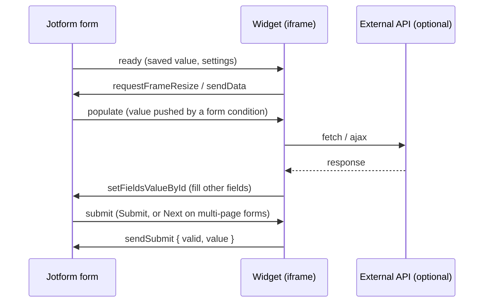

| Event | When it fires | What widgets usually do |
| --- | --- | --- |
| `ready` | Form and iframe have loaded. `data.value` is the saved value when a submission is edited. | Read settings with `getWidgetSettings()`, restore the value, build the UI. |
| `populate` | A form condition (e.g. *Update/Calculate field*) sends a value to the widget. | Use the value: draw a chart, look something up, classify text. |
| `submit` | Submit is pressed, or Next on a page break (the handler gets `true` for Next). | Validate and call `sendSubmit({ valid, value })`. |
| `next`, `clear`, `show` | Next button, form cleared, widget shown. | Rarely used (`IBCClientIdLookUp` uses `show`). |

Useful calls:

| Call | Use |
| --- | --- |
| `getWidgetSettings()` / `getWidgetSetting(name)` | Read the widget's settings (the **User Parameters** from its registration). Values are always strings (`"Yes"`, not `true`). |
| `getFieldsValueById([ids], cb)` / `getFieldsValueByName([names], cb)` | Read other fields. Result is `res.data[i].value`. |
| `setFieldsValueById([{ id, value }])` / `setFieldsValueByLabel([{ label, value }])` | Write other fields. |
| `sendData({ value })` | Update the widget's value while the user works. |
| `sendSubmit({ valid, value })` | Answer the `submit` event. `valid: false` stops the submission. `value` is what Jotform saves. |
| `showWidgetError(msg)` / `hideWidgetError()` | Show or clear the red error under the field. |
| `requestFrameResize({ height })` | Resize the iframe to fit the content. |
| `JFCustomWidgetUtils.buildMetadata('htmltext', base64Html)` | Save an HTML table that shows as a table in Submissions and PDFs. |
| `JFCustomWidgetUtils.buildMetadata('imagelinks', [{ name, base64 }])` | Save an image (e.g. a chart). |

Things that are easy to get wrong:

- **Setting names must match exactly.** The code reads each setting by name, e.g. `getWidgetSettings()["apiKey"]`. The User Parameter in the registration must have exactly that name, including capitals and spaces. If it doesn't, the widget gets `undefined` and quietly fails.
- `sendData`, `sendSubmit` and `requestFrameResize` take an **object** (`{ value }`, `{ height }`). The library adds fields to that object before sending it, so a plain string or number does not get through.
- Only **one** `submit` handler is kept. Subscribing again replaces the previous one.
- Every widget file is public. Anything in it, including URLs and keys, can be read by anyone. Several older widgets take an `apiKey` setting and send it from the browser. Don't do this for new widgets.

---

## Widget catalogue

Each entry shows the widget in use and says what it does. **Settings to register** lists the User Parameters the code reads: copy each name exactly into the widget's registration. "Hard-coded" means a value is written into the code and has to be edited for another form.

### Lookups and dropdowns

#### CourseLookupDropDownWidget
[Code](CourseLookupDropDownWidget.html)

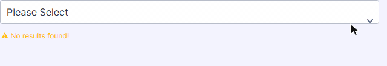

Loads every submission of a course form (hard-coded form `250493468935065`) through the Jotform API and lists them as `ID - Course name`. Choosing a course fills the fields labelled **Course Name**, **Course ID**, **Course Owner** and **Course Owner Email**.

| Settings to register | What to enter |
| --- | --- |
| `apiKey` | Jotform API key that can read the course form |

#### ActiveDirectoryDropDown
[Code](ActiveDirectoryDropDown.html)

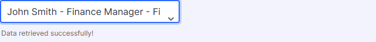

The first version of the approver dropdown that later became the EEL AD Widget. A condition pushes a job title in (`populate`), the widget fetches matching people and groups them into *Job Title* and *Department* results. The first match is picked automatically, and the chosen email is written to another field. **Note:** the API address has been removed from this copy (the URL is just `jobTitle=…`), so it needs a real endpoint before it will work.

| Settings to register | What to enter |
| --- | --- |
| `fieldToFill` | ID of the field that receives the chosen person's email |

#### IBCClientIdLookUp
[Code](IBCClientIdLookUp.html)

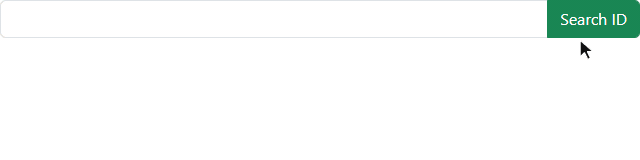

Type a client ID and press **Search ID**. The widget calls a Salesforce API (via AWS API Gateway), shows the client's name, date of birth and country of arrival, and writes the Salesforce IDs into fields `336` and `337` (hard-coded).

| Settings to register | What to enter |
| --- | --- |
| `apiKey` | Key for the client API (sent as an `apikey` header) |

#### lookupWidget
[Code](lookupWidget.html) · test copy: [lookupWidgetDev](lookupWidgetDev.html) (only loads the first 8 records, same settings)

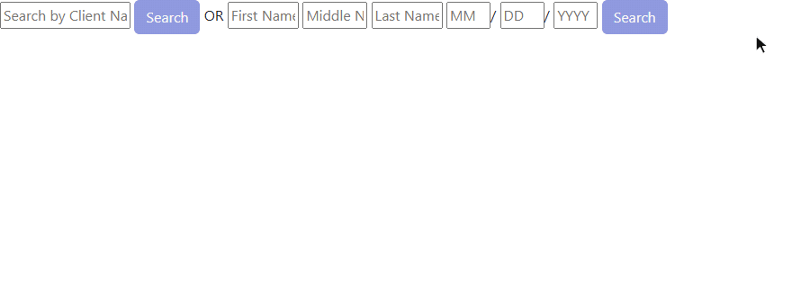

Searches client records in a Jotform report, by name or by name and date of birth, and shows them in a paged table. **Select** copies the record into the current form. The client form (`231172796476870`) is hard-coded.

| Settings to register | What to enter |
| --- | --- |
| `apiKey` | Jotform API key |
| `formId` | ID of the form the widget is on. It decides the table columns and which fields get filled, so it must be one of `231183863105856`, `231156624458862`, `231173448610855`, `231174162082852` or `231166137203850`. |
| `reportId` | ID of the report (list) that holds the client records |

#### housingAssignmentWidget
[Code](housingAssignmentWidget.html)

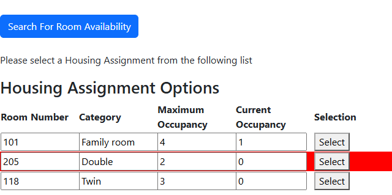

Reads the household's details from fields `3`, `8`, `5`, `6` (guest ID, household size, pets, accessibility; hard-coded). **Search For Room Availability** lists rooms from the housing form (`230735264344050`) that are free, big enough and match the needs. On submit, the selected room is marked *Occupied* through the Jotform API.

| Settings to register | What to enter |
| --- | --- |
| `apiKey` | Jotform API key that can read and update the housing form |

#### getPrefilledURL
[Code](getPrefilledURL.html)


Finds a candidate's submission from the fields with unique names `iqxReference` and `email`, reads that submission's email thread, and pulls out the prefilled link from the email whose subject matches. **Copy** puts the link on the clipboard.

| Settings to register | What to enter |
| --- | --- |
| `apiKey` | Jotform API key |
| `emailSubject` | Subject of the email that contains the link, exactly as sent |

#### getInfoWidget
[Code](getInfoWidget.html)


Reads the field with unique name `originalSubmission`, fetches that submission and shows its status as a progress bar: Awaiting Review 25%, In Progress 50%, Approved 100%.

| Settings to register | What to enter |
| --- | --- |
| `apiKey` | Jotform API key |

#### updateClientRecord
[Code](updateClientRecord.html)


Finds the original client record from the `clientId` field and, on submit, updates it through the Jotform API. The two **Test** buttons are left over from development.

| Settings to register | What to enter |
| --- | --- |
| `apiKey` | Jotform API key |
| `reportId` | ID of the report (list) that holds the client records |

### Inputs and tables

#### IBCPickerWidget
[Code](IBCPickerWidget.html) · test copy: [DevIBCPickerWidget](DevIBCPickerWidget.html) (tiles keep their natural width, same settings)

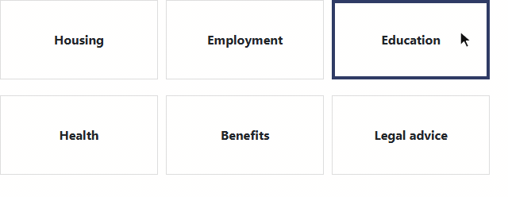

Shows up to 10 options as tiles in one or two rows. Single or multiple choice. Multiple choices are saved joined with `; `.

| Settings to register | What to enter |
| --- | --- |
| `optionLabels` | The options, one per line (use a Textarea parameter) |
| `allowMultipleSelection` | `Yes` or `No` |
| `fontSize` | Text size in pixels, e.g. `16` |

#### SOCWidget
[Code](SOCWidget.html) · identical copy: [TableWidget](TableWidget.html) · test copy: [SOCWidgetDev](SOCWidgetDev.html) (same settings)

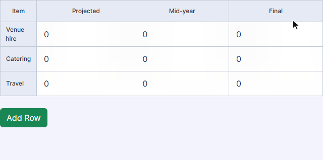

An expenses table built from settings, with **Add Row** and **Remove**. The three number columns are totalled into three form fields. The table is saved as an HTML table (`htmltext`), so it shows as a table in submissions and is rebuilt when a submission is edited.

| Settings to register | What to enter |
| --- | --- |
| `Columns` | Column names, one per line. The first column holds the row names. Add `:` to a name to make it a text column; other columns take numbers. |
| `Rows` | Row names, one per line. Add `:` to a name to make it a heading row. |
| `Total Projected Expenses Field ID` | ID of the field for the first number column's total |
| `Total Mid-year Expenses Field ID` | ID of the field for the second number column's total |
| `Total Final Expenses Field ID` | ID of the field for the third number column's total |

The three total names contain spaces and capitals. They must be registered exactly as shown.

#### experienceEducationWidgetV2
[Code](experienceEducationWidgetV2.html) · older versions: [educationExperienceList](educationExperienceList.html) (same settings), [edExV4](edExV4.html), [expEdv3](expEdv3.html)

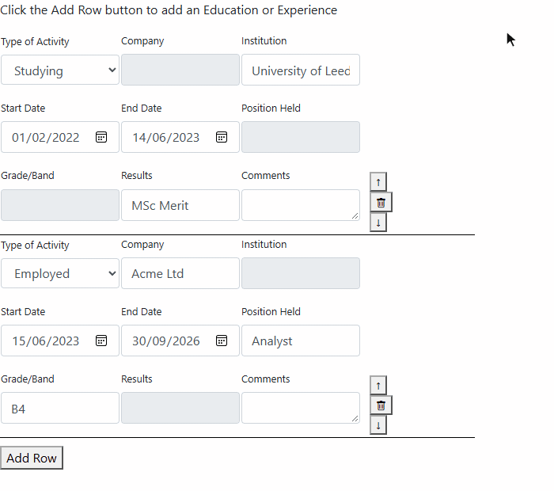

A work and education history table. The fields on each row change with the type of activity (Employed, Studying, Traveling…). It checks the dates, can check for gaps in the history, and writes company names into separate fields. The table is saved as `htmltext` and restored when a submission is edited.

A gap turns both dates red and writes `Yes`/`No` into field `439`, or field `215` when `fullWorkHistory` is `Yes` (both hard-coded). The check compares calendar months, so a row ending 30 June followed by one starting 1 July counts as a gap.

| Settings to register | What to enter |
| --- | --- |
| `storageField` | ID of a field that keeps a copy of the table data |
| `fullWorkHistory` | `Yes`: dates are allowed back to age 18, using the date of birth in field `11` (hard-coded). `No`: only dates from 1 January five years ago. |
| `companyField1` … `companyField6` | IDs of six fields that receive the company names, one setting each |

#### homeLinkFullHistory
[Code](homeLinkFullHistory.html)

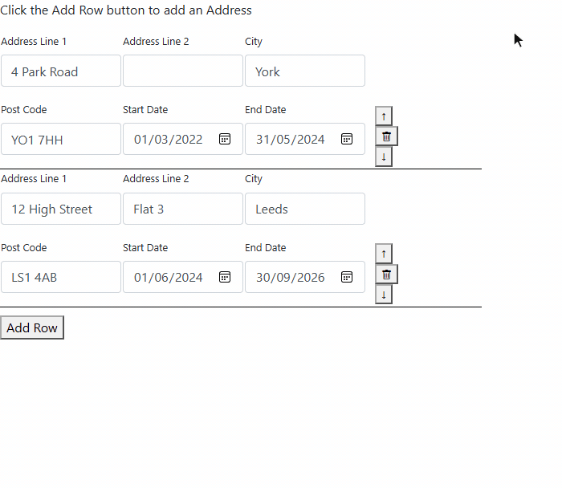

The same table adapted for address history (Address Line 1 and 2, City, Post Code, dates), with date checks between consecutive rows.

| Settings to register | What to enter |
| --- | --- |
| `storageField` | ID of a field that keeps a copy of the table data |
| `fullWorkHistory` | `Yes` or `No`. With `No`, only dates from 1 January five years ago are accepted. |

### AI, media and device widgets

#### DataExtractAI
[Code](DataExtractAI.html)

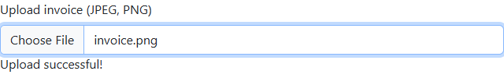

Upload an invoice (image or PDF). The file and the questions go to an AI document Q&A service, and the answers are written into four fields.

| Settings to register | What to enter |
| --- | --- |
| `fieldIds` | Four field IDs, comma-separated, in this order: issue date, invoice number, due date, total |
| `questions` | The questions sent to the service. The code reads the answers to these exact questions: `What is the invoice issue date?`, `What is the invoice number?`, `What is the invoice due date?`, `What is the total amount?` |

#### SpeechToForm
[Code](SpeechToForm.html)

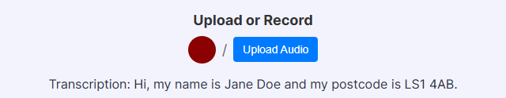

Record with the red button (click again to stop) or upload an audio file. The service transcribes it, shows the transcription, and answers a question for each field. Each answer is written to its field.

| Settings to register | What to enter |
| --- | --- |
| `fieldMapping` | Field IDs and the question to answer for each, e.g. `{"3": "What is the caller's name?"}`. Answers come back keyed by field ID. |

#### ocrWidget
[Code](ocrWidget.html)


Reads the text in an uploaded JPEG or PNG in the browser with Tesseract.js (nothing is sent to a server) and saves the text as the widget's value.

**Settings to register:** none.

#### takeAPhotoWidget
[Code](takeAPhotoWidget.html)


Meant to show the camera and save a photo as the widget's value. **It doesn't work in current browsers:** it uses `navigator.getUserMedia` and `createObjectURL(stream)`, which have been removed, so the camera never starts (as in the screenshot). Update it to `navigator.mediaDevices.getUserMedia` and `video.srcObject` before using it.

**Settings to register:** none.

### Charts

All charts use Chart.js. None of them has settings, so there are no **Settings to register**. The data comes from a form condition (`populate`) or from other fields, and the ROI charts save the chart as an image (`imagelinks`) on submit.

#### ROIChartWidget
[Code](ROIChartWidget.html) · earlier version: [chartWidget3](chartWidget3.html)

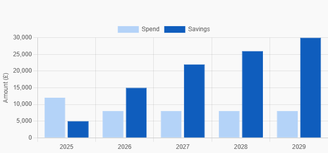

Spend vs savings bar chart. Use an *Update/Calculate field* condition to send it a value like:

```
Costs:12000,8000,8000,8000,8000;Savings:5000,15000,22000,26000,30000;Years:2025,2026,2027,2028,2029
```

`Years` replaces the x-axis labels and must be numbers. `chartWidget3` is the same chart with the legend at the bottom, labelled *Current Spend* / *Potential Spend*.

#### chartWidget2
[Code](chartWidget2.html)

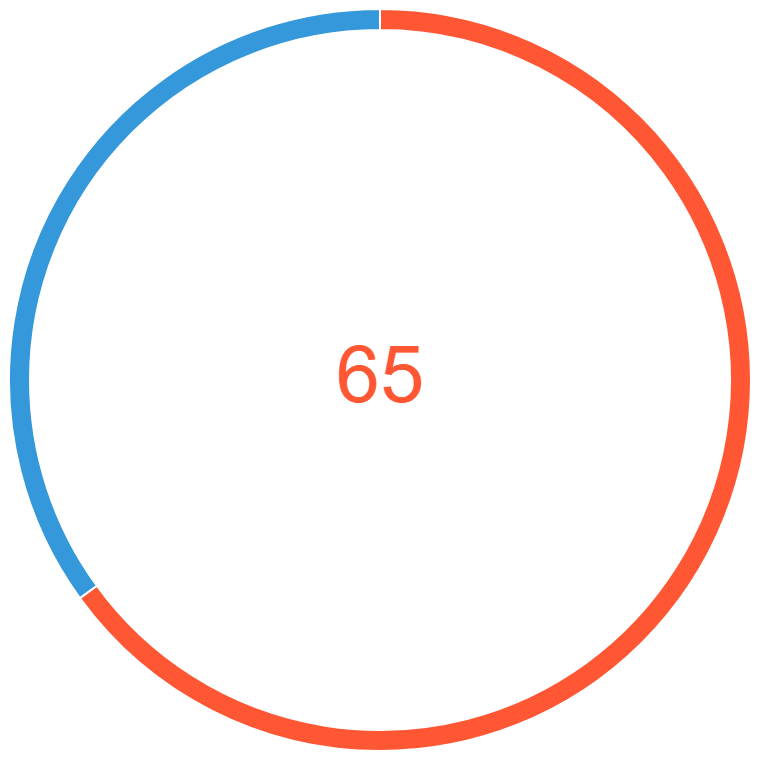

Doughnut chart of two values (`Invested`, `Profit`) from a value like `65,35`. Hovering a slice shows its value in the middle. The ring has a fixed 350px cut-out, so it needs a widget at least about 720px wide.

#### chartWidget
[Code](chartWidget.html)

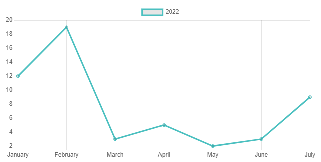

Line chart of seven monthly values, read on load from fields with the unique names `data1`–`data7`. Doesn't save anything on submit.

### Widgets with no visible UI

These run in the background, so there is nothing to show.

| Widget | What it does | Settings to register |
| --- | --- | --- |
| [FormClassification](FormClassification.html) | Text pushed in by a condition is sent to an AI classifier, and the returned label is written into a field. | `fieldToFill`: ID of the field for the label |
| [PrefillHandler](PrefillHandler.html) | Copies field `506` into field `494` on load, and sets `494` from `populate`. Field IDs are hard-coded. | none |
| [RefWidget](RefWidget.html) | Reference workflow helper. Reads values from the original submission, updates it, finds open approval tasks and marks reference tasks complete through the Jotform Workflow API. | `apiKey`: Jotform API key |

### Older and prototype files

| File | What it is | Settings to register |
| --- | --- | --- |
| [nwuWidget](nwuWidget.html) | NWU student checks. The student number comes in by `populate`, and two NWU APIs are called synchronously (NSFAS check, then residence placement). The page only ever shows "Loading.....". | `displayName` |
| [splitter3](splitter3.html) | Variant of `nwuWidget` that also sends the whole page to an NWU form after 40 seconds. | `displayName` |
| [bpWidget](bpWidget.html) | Prototype that sends a SOAP request to a placeholder endpoint when **Read** is clicked. | `displayName` |

---

## Templates for new widgets

The [templates/](templates/) folder has a working starting point for each kind of widget in this repo. Each one is a complete HTML file with comments, and they all follow the same pattern:

- subscribe to `ready`, `populate` and `submit` at the top level
- read settings in `ready`
- restore the saved value when a submission is edited
- validate required fields in `submit` with `sendSubmit({ valid, value })`
- resize the iframe

The comment at the top of each template lists its **User Parameters**. Register those names exactly, or rename them in both places.

| Template | Use it to… | Settings it reads | Based on |
| --- | --- | --- | --- |
| [basic-input.html](templates/basic-input.html) | Collect one value. The simplest complete widget, so start here. | `placeholder` | – |
| [api-lookup.html](templates/api-lookup.html) | Look up or validate a code against an API, show the result and fill another field. Includes debounce and stale-response handling. | `apiUrl`, `targetFieldId` | EEL Location widget, `IBCClientIdLookUp` |
| [api-dropdown.html](templates/api-dropdown.html) | Fill a dropdown from an API and copy details of the choice into other fields. | `apiUrl`, `nameFieldId`, `emailFieldId` | `CourseLookupDropDownWidget` |
| [option-picker.html](templates/option-picker.html) | Show clickable options defined in a setting, single or multiple choice. | `options`, `allowMultiple` | `IBCPickerWidget` |
| [table.html](templates/table.html) | Collect repeating rows. Saves as an HTML table, restores on edit, can total a column into a field. | `columns`, `totalColumn`, `totalFieldId` | `SOCWidget`, `experienceEducationWidgetV2` |
| [chart.html](templates/chart.html) | Draw a chart from values pushed in by a condition and save it as an image. | `title` | `ROIChartWidget` |
| [file-upload.html](templates/file-upload.html) | Send a file to an API (e.g. AI extraction) and fill fields from the answer. | `apiUrl`, `fieldMap`, `accept` | `DataExtractAI`, `SpeechToForm` |
| [background.html](templates/background.html) | Work behind the scenes with no UI: read or receive a value, process it, write it into a field. | `sourceFieldId`, `targetFieldId` | `FormClassification`, `PrefillHandler` |
| [custom-setting-page.html](templates/custom-setting-page.html) + [custom-setting-widget.html](templates/custom-setting-widget.html) | Give a widget a **custom setting**: its own settings page in the Form Builder instead of a plain text box. See [Custom settings](#custom-settings) below. | `config` (the custom setting) | EEL `ADWidgetSettings` + AD Widget |

These replace the old `BasicTemplate` from the EEL widget README, which had these problems:

- Its `subscribe` calls were inside a constructor that was never called, so the widget never started.
- `_data` was never set, so `_data.valid` threw an error.
- The required check always showed "Test".
- The library was loaded twice.
- `requestFrameResize` was given a hard-coded width of 1000.

### Custom settings

Most settings are plain User Parameters: a text box that whoever adds the widget to a form fills in. A **custom setting** replaces that text box with your own web page, shown in the widget's settings panel in the Form Builder. Use one when a setting is too complex for a text box: choices that show or hide other inputs, lists of tags, several related values. The EEL AD Widget uses this. Its behaviour picker, `ADWidgetSettings.html` in the EEL-Widgets repo, saves to a parameter named `selectedBehaviour`.

A custom setting has two parts:

| Part | Template | What it does |
| --- | --- | --- |
| Settings page | [custom-setting-page.html](templates/custom-setting-page.html) | Loads `https://cdn.jotfor.ms/s/umd/latest/for-widgets-client.js` (`JFExternalWidgetParamsClient`, not `JFCustomWidget`). On `ready` it restores the saved value. On every change it calls `sendParamData({ value })`. It calls `requestFrameResize(height)` when its height changes. |
| Widget | [custom-setting-widget.html](templates/custom-setting-widget.html) | Reads the saved value with `JFCustomWidget.getWidgetSettings()["config"]` and uses it, here to build a dropdown from a typed list or an API. |

How it works and what to watch for:

- Jotform opens the settings page with `?qid=…&name=…` in its URL. `name` is the User Parameter the page saves to, and the widget must read that **same name**.
- The saved value can be an object (anything JSON can hold). The widget usually receives it as an object, but should also accept a JSON string. Before anything is saved, the page may be given a URL instead of a value. Treat that as empty, as `ADWidgetSettings.html` does.
- **Save on every change.** The settings library only ever sends `ready`, never `submit`, so a "save on submit" handler never runs.
- `requestFrameResize` on the settings page takes a plain number (pixels). On a widget it takes `{ height }`.
- The settings page is a separate HTML file with its own URL, hosted alongside the widget.
- To register it, add a User Parameter with the name the widget reads (`config` in the template), and set its input to the settings page's URL instead of a text box. Jotform's public docs don't describe this option, so copy how the AD Widget's `selectedBehaviour` parameter is set up in the EEL Jotform account.

### Making a widget from a template

1. Copy the closest template to the repo root and give it a clear name (e.g. `PostcodeLookup.html`). Make a second copy ending in `Dev` for testing.
2. Change the parts marked in the comments: settings, API request and response, field IDs.
3. Push to `main`. After the Pages deploy finishes, the file is at `https://digibluuk.github.io/PostcodeLookup.html`.
4. Register it in Jotform (below), add it to a test form and test it. Then add an entry for it to this README, with its **Settings to register** table.

---

## Registering and testing a widget

1. In Jotform, go to [Widgets](https://www.jotform.com/widgets/) and choose **Add New Widget**.
2. Fill in the name, a short description, a screenshot (any image) and a category, then choose **iFrame Widget** as the type.
3. Set **Widget Width** and **Height** and the **Widget iFrame URL** (the GitHub Pages URL).
4. Add a **User Parameter** for every name in the widget's **Settings to register** table. Copy the name exactly: capitals and spaces matter (`apiKey` is not `APIKey`, and `Total Projected Expenses Field ID` needs its spaces). For lists entered one per line (e.g. `optionLabels`, `Columns`), use a Textarea parameter. For a [custom setting](#custom-settings), point the parameter at its settings page.
5. Click **Add**. The widget can now be used in the Form Builder. On an enterprise account, a support ticket to Jotform is needed to add it.

When testing on a form:

- Open the browser console (F12). Most widgets log their settings, values and API calls. If a setting shows as `undefined`, its name in the registration doesn't match the code.
- Mark the widget **Required** and submit with and without a value.
- Edit an existing submission to check that the saved value comes back.
- On multi-page forms, check the **Next** button too. It also fires `submit`.
- Check the form at phone width.
